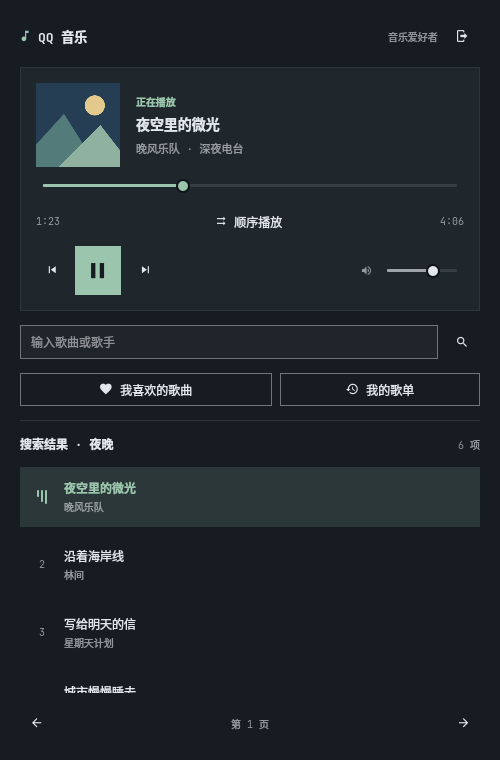

# omaqqmusic — QQ 音乐 Omarchy 原生插件



在 Omarchy 顶栏内使用手机 QQ 扫码登录、搜索歌曲、读取自己的歌单并直接播放。无需打开浏览器。QML 面板使用 Omarchy 主题，Python 本地服务请求 QQ 音乐接口，mpv 负责播放。

## 界面

固定播放卡片 + 独立滚动曲库：浏览歌曲时仍能控制播放、进度与音量。唱片图形、当前曲目高亮、收藏/歌单选中态、账号入口、搜索和分页按视觉层级排列。颜色、字体、圆角与动画设置跟随 Omarchy；简体中文与英文文案随桌面语言切换，支持 `zh` 和 Omarchy 简体中文区域代码 `zh-CN`。

参考 Omarchy 原生媒体与音量面板的控件规范，并借鉴 [Omaspotify](https://github.com/nixfred/omaspotify) 的迷你播放器与曲库分区思路。播放卡片显示当前歌曲的专辑封面，暂停时保留；封面缺失、加载中或加载失败时显示本地唱片图形。仅加载当前曲目的封面，不预加载搜索结果或歌单中的图片。

键盘支持 Tab / Shift+Tab 切换控件、Enter / Space 激活按钮或歌曲，搜索框回车搜索。歌曲获得键盘焦点时自动滚动到可见位置。进度拖动显示正在选择的时间。

## 安装或升级

需要本机已安装支持 `omarchy plugin` 的 Omarchy Shell、Python 3 和 mpv。没有第三方 Python/npm 依赖。

```bash
# 缺少依赖时执行
omarchy pkg add python mpv

# 首次安装
omarchy plugin add https://github.com/panjie/omaqqmusic.git --enable

# 后续升级
omarchy plugin update panjie.omaqqmusic
```

Omarchy 会克隆仓库、验证根目录的 `manifest.json` 并启用插件，无需手动执行 `install.sh`。插件 ID 为 `panjie.omaqqmusic`，默认放在顶栏右侧；交互安装时也可以选择其他位置。当前 Omarchy CLI 安装到 `~/.config/omarchy/plugins/panjie.omaqqmusic`，保留 Git 信息供后续更新。`plugin add` 不会自动安装 Python 或 mpv，请先确保上述依赖已安装。

若安装成功但启用失败，可执行：

```bash
omarchy plugin enable panjie.omaqqmusic --section right
```

如果升级后仍显示旧界面，请在桌面终端运行 `omarchy restart shell`，再重新打开插件。此操作会重启顶栏并中断当前播放。

### 从旧版 local.qqmusic 迁移

插件 ID 已从 `local.qqmusic` 改为 `panjie.omaqqmusic`。若安装过旧 ID 的版本（包括通过 `plugin add` 安装），请先停用并将旧目录移到插件发现目录之外，再使用新命令安装，避免两个版本同时运行。旧脚本安装的文件副本不包含 Git 信息，不能直接执行 `plugin update`：

```bash
omarchy plugin disable local.qqmusic
config_root="${XDG_CONFIG_HOME:-$HOME/.config}"
mkdir -p "$config_root/omarchy/plugin-backups"
mv -- "$config_root/omarchy/plugins/local.qqmusic" \
  "$config_root/omarchy/plugin-backups/local.qqmusic.$(date +%Y%m%d-%H%M%S).$$"
omarchy plugin add https://github.com/panjie/omaqqmusic.git --enable
```

登录凭证位于独立的状态目录，迁移保留登录状态。若设置了自定义 `XDG_CONFIG_HOME`，请注意旧脚本遵循该变量，而当前 Omarchy CLI 使用上述 `~/.config` 路径。

### 本地开发安装

仍可在源码目录运行 `bash install.sh`，验证后复制文件并启用到顶栏右侧；已有版本会备份到 `${XDG_CONFIG_HOME:-$HOME/.config}/omarchy/plugin-backups/`。此方式不保留 Git 信息，后续更新需在源码目录执行 `git pull --ff-only` 和 `bash install.sh`。请勿用它覆盖通过 `plugin add` 安装、需要由 `plugin update` 管理的目录。

## 使用

1. 点击顶栏 `♪ QQ 音乐`，点击右上角 **登录**。
2. 用手机 **QQ** 扫描二维码并确认授权；目前不支持微信账号扫码。
3. 输入歌曲或歌手，回车或点击搜索。点击搜索结果直接播放。
4. 登录后点击 **我喜欢的歌曲** 一键打开喜欢列表，或点击 **我的歌单** 浏览全部歌单（首项为我喜欢的歌曲）；点击歌曲即可播放。正在播放的行会高亮并显示均衡器动画。
5. 当前结果页构成播放队列，播完自动播放下一首。点击进度条下方的“顺序播放 / 随机播放”按钮切换模式，不中断当前歌曲。顺序模式按列表顺序播放；随机模式将当前歌曲放在首位，并打乱其余歌曲，每首播放一次，队列播完停止。上下首遵循当前模式的队列顺序。切回顺序模式后从当前歌曲所在位置继续。播放模式在本次服务运行期间保留，重启服务后恢复顺序播放。之后搜索其他内容不会改变正在播放的队列，直到点击新的歌曲。

打开歌单或“我喜欢的歌曲”后，点击搜索框左侧的“在线搜索”切换为“当前歌单”，输入歌曲名、歌手或专辑即可即时过滤，不发起网络请求。清除关键词恢复完整列表，切回“在线搜索”可继续搜索 QQ 音乐。仅搜索当前已加载的最多 200 首；过滤不改变播放队列，点击匹配歌曲仍按完整歌单及所选播放模式继续播放。

支持播放/暂停、上下首、进度拖动、音量调整；中键点击顶栏可播放/暂停。关掉面板后继续播放。多个显示器共享同一个服务和队列；重新加载插件会停止播放，登录状态保留。

搜索每页 30 首，可翻页；歌单（含我喜欢的歌曲）当前最多显示前 200 首，个人歌单列表最多 100 项。暂未实现收藏操作、歌词、音质选择、媒体快捷键/MPRIS 导出。音频请求使用 128kbps MP3，实际可播放内容取决于 QQ 音乐返回的地址和账号权限。

## 登录状态与网络

登录二维码只在点击登录时请求；随后每 2.5 秒检查状态，最长 2 分钟，可点击取消。搜索、歌单、选歌和队列自动切歌会请求腾讯接口，音频播放访问腾讯 CDN，播放卡片的专辑封面通过 HTTPS 从 `y.gtimg.cn` 加载，不附带音乐登录凭证。没有网页取 Cookie、外部扫码代理或后台推荐轮询。

音乐登录凭证保存在 `${XDG_STATE_HOME:-$HOME/.local/state}/omarchy-qqmusic/session.json`，目录权限 `0700`，文件权限 `0600`。文件是本机明文凭证，不应分享；凭证不进入 QML、命令行参数或日志。点击退出登录会删除该文件并停止播放。登录状态过期时需重新扫码。

本地服务由插件生命周期管理，通过标准输入/输出收发 JSON；mpv 使用继承的私有 socket 通信，不开 HTTP/TCP 监听端口。关闭服务也会关闭它启动的播放器。

接入依据是社区公开实现的 QQ 音乐网页协议，不是腾讯官方稳定 SDK。上游变更、额外登录验证、地区或账号权限都可能导致失败。界面会显示错误，不会在没有播放地址时伪造成功，也不绕过会员限制。

## 验证

```bash
bash tests/check.sh
# 歌单内搜索的 QML 行为测试与预览（无需网络）
bash tests/preview.sh playlist-search /tmp/qqmusic-playlist-search.png
# 在真实桌面终端额外验证 mpv IPC（不播放声音）
python3 -B tests/check_mpv.py
```

自动测试使用模拟的腾讯响应，覆盖登录状态机、OAuth 交换、凭证文件权限、地址校验、搜索与歌单解析、队列、EOF 自动切歌、错误信息脱敏和 stdio 生命周期。`playlist-search` 预览额外验证歌曲名、歌手和专辑过滤、清空恢复、搜索范围切换，以及过滤后的播放索引；成功时输出 `PLAYLIST_SEARCH_TESTS_PASSED`。

开发环境已验证 Python 服务启动和原生面板内容加载，但无法连接桌面 Wayland/DBus，且禁止 socket 通信和直接访问腾讯网络。**真实扫码授权、顶栏窗口交互和在线音频播放仍需在你的桌面完成验证。** 安装后依次确认：扫码成功 → 搜索返回 → 播放出声 → 暂停/切歌 → 关闭面板仍播放 → 重开保留登录 → 退出后凭证删除。

## 离屏界面预览

使用真实 Omarchy 控件和虚构数据渲染，不启动 QQ 服务、不访问账号或播放音频：

```bash
bash tests/preview.sh playing /tmp/qqmusic.png
bash tests/preview.sh compact /tmp/qqmusic-compact.png
QQ_PREVIEW_LANGUAGE=en bash tests/preview.sh empty /tmp/qqmusic-empty.png
```

也支持 `login`、`playlists`、`error`、`light`、`shuffle`、`cover`（本地模拟封面）、`cover-error`（封面加载失败回退）场景。登录预览只显示不可扫码的占位图。预览调色只作用于该独立进程，不修改桌面主题；受限环境下 Quickshell 的 IPC/Hyprland 连接警告不影响截图。

仓库根目录的 `preview.png` 用于插件市场展示，`docs/preview.png` 保留为本地安装副本。两张图片均使用上述虚构数据生成，可在项目目录更新：

```bash
bash tests/preview.sh cover "$PWD/preview.png"
cp preview.png docs/preview.png
```

## 停用与清理

仅停用（保留插件文件和登录状态）：

```bash
omarchy plugin disable panjie.omaqqmusic
```

卸载通过 `omarchy plugin add` 安装的插件：先在插件内点击“退出登录”清除凭证，再执行以下命令并按提示确认。该命令移除插件目录并卸载运行中的插件：

```bash
omarchy plugin remove panjie.omaqqmusic
```

若已卸载但未退出登录，可单独清除残留凭证：

```bash
rm -f -- "${XDG_STATE_HOME:-$HOME/.local/state}/omarchy-qqmusic/session.json"
```

`plugin remove` 不清理独立的状态目录；不删除凭证时，重新安装会恢复登录状态。不要在服务仍运行时手动删除凭证。

通过 `install.sh` 安装到默认配置目录的文件副本也可用 `plugin remove` 移除，Omarchy 会将其改名备份。若本地开发安装使用了自定义 `XDG_CONFIG_HOME`，请先执行上述停用命令，再手动移除 `${XDG_CONFIG_HOME}/omarchy/plugins/panjie.omaqqmusic`，因为当前 Omarchy CLI 的移除命令只查找 `~/.config`。不再需要的备份可从 `${XDG_CONFIG_HOME:-$HOME/.config}/omarchy/plugin-backups/` 清理；插件备份不包含账号凭证。

接口来源与许可证见 [THIRD_PARTY_NOTICES.md](THIRD_PARTY_NOTICES.md)。

## 许可证

项目采用 [MIT License](LICENSE)，第三方协议实现的来源与许可保留在 [THIRD_PARTY_NOTICES.md](THIRD_PARTY_NOTICES.md)。本项目是独立的社区插件，与腾讯 QQ 音乐没有隶属关系。
